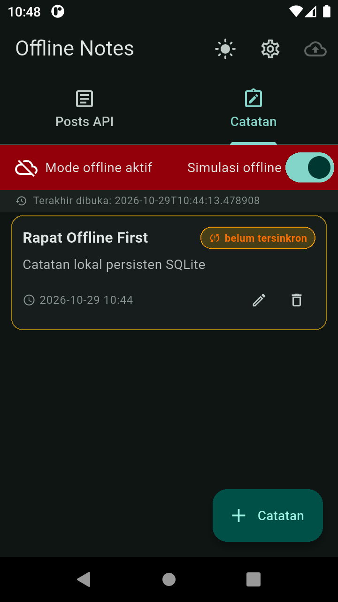
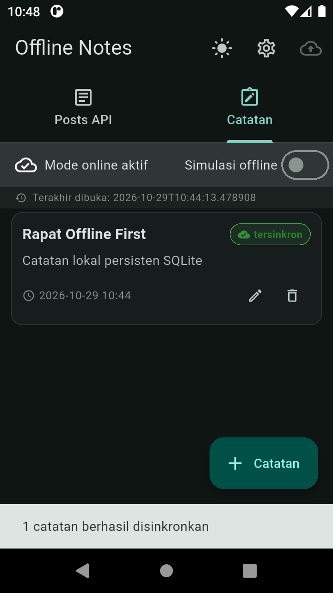
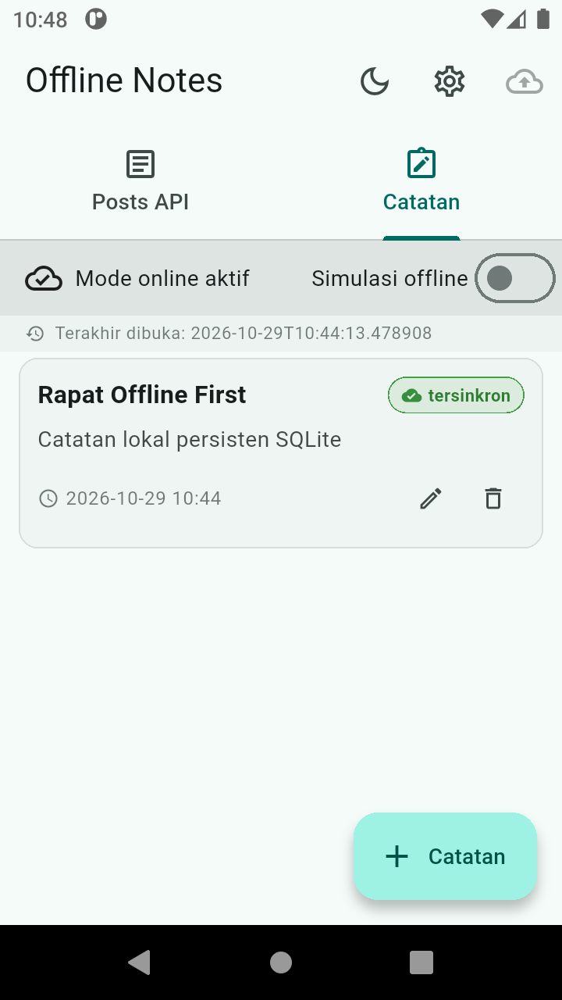
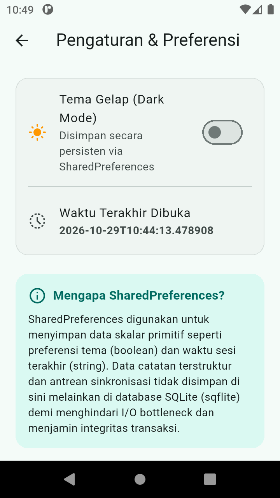
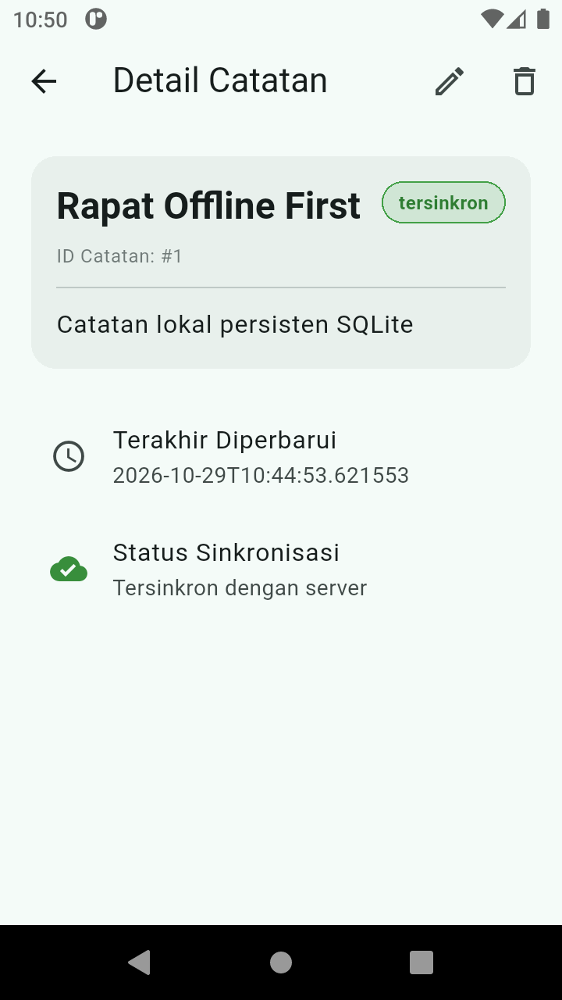

# Week 5: Local Storage & Offline-First Notes Application

Aplikasi Flutter **Offline Notes** dengan arsitektur penyimpanan lokal hibrida (*Dual-Storage Architecture*): **SharedPreferences** untuk pengaturan preferensi aplikasi dan **SQLite (`sqflite`)** untuk persistensi catatan serta *cache-first reading*. Proyek ini mendemonstrasikan pola desain **Offline-First**, *dirty flag synchronization queue*, resolusi konflik **Last-Write-Wins (LWW)**, dan manajemen state reaktif menggunakan **Flutter Riverpod**.

---

## 1. Tujuan Proyek

1. **Memisahkan Peran Storage Secara Tepat**: Menerapkan SharedPreferences murni untuk data skalar primitif (tema dan waktu buka terakhir) dan SQLite untuk data terstruktur dengan relasi, indeks, dan kemampuan query.
2. **Pola Offline-First**: Memprioritaskan ketersediaan data lokal (cache-first read), memungkinkan operasi tulis saat tidak ada internet (*optimistic write* dengan `dirty flag`), dan menyediakan sinkronisasi ke server saat koneksi pulih.
3. **Arsitektur Bersih & Teruji**: Memisahkan lapisan data (`repositories/`, `local/`), logika state (`providers.dart`), dan antarmuka pengguna (`pages/`, `widgets/`) dengan unit test serta provider test menggunakan *fake repository pattern*.

---

## 2. Fitur Utama

- **Preferensi Tema Gelap / Terang (SharedPreferences)**: Mengatur dan menyimpan preferensi tema aplikasi secara persisten tanpa perlu pembacaan database berat.
- **Pencatatan Waktu Buka Terakhir (SharedPreferences)**: Mencatat timestamp ISO-8601 sesi sebelumnya (`last_opened_at`) dan menampilkannya pada banner aplikasi serta halaman pengaturan.
- **CRUD Catatan Persisten (SQLite / `sqflite`)**: Operasi *Create, Read (Detail & List), Update, Delete* catatan langsung ke database SQLite lokal, diurutkan berdasarkan `updated_at DESC`.
- **Dirty Flag & Antrean Sinkronisasi (`syncNotes`)**: Setiap mutasi lokal menandai `dirty = 1`. Tombol sinkronisasi mengirimkan catatan kotor ke server dan memperbarui status menjadi `dirty = 0`.
- **Cache-First REST API (`/posts`)**: Menampilkan data cache lokal terlebih dahulu sebelum melakukan fetching jaringan di latar belakang, menjaga aplikasi tetap responsif tanpa koneksi internet.
- **Simulasi Mode Offline**: Switch deterministik di UI untuk menguji skenario putusnya koneksi jaringan tanpa perlu mematikan koneksi fisik perangkat emulator.

---

## 3. Stack Teknologi

| Komponen | Pustaka / Teknologi | Alasan Pemilihan |
| :--- | :--- | :--- |
| **Framework** | Flutter 3 (Dart 3) | Framework multiplatform deklaratif dengan performa native. |
| **Local Relational DB** | `sqflite` & `path` | Mesin SQLite native Android/iOS, mendukung query SQL standar, transaksi ACID, B-Tree index, dan *zero code-generation* (`build_runner` tidak diperlukan). |
| **Key-Value Store** | `shared_preferences` | Pustaka standar dan ringan untuk preferensi skalar tunggal (`isDarkMode`, `lastOpenedAt`). |
| **State Management** | `flutter_riverpod` (v3) | Manajemen state reaktif modular dengan `AsyncNotifier` dan invalidasi otomatis tanpa *boilerplate* berlebih. |
| **HTTP Client** | `dio` | Networking handal dengan timeout, error mapping, dan interceptor. |
| **Navigasi** | `go_router` | Routing deklaratif berbasis URI yang mendukung parameterized route (`/note/:id`). |

---

## 4. Struktur Project

```text
05-week-5-local-storage-offline-first/
├── docs/
│   ├── AI_CHALLENGE.md              # Analisis komparasi SharedPreferences, Hive, sqflite, Drift
│   └── AI_VERIFICATION.md           # Verifikasi dan evaluasi kritis rekomendasi AI
├── lib/
│   ├── data/
│   │   ├── local/
│   │   │   ├── db.dart              # Inisialisasi SQLite database & skema tabel
│   │   │   └── note.dart            # Model data Note (fromMap/toMap serialisasi)
│   │   ├── models/
│   │   │   └── post.dart            # Model data REST API Post
│   │   ├── repositories/
│   │   │   ├── note_repository.dart # CRUD SQLite & pelacakan status dirty
│   │   └── posts_repository.dart# Cache-first repository untuk REST API
│   │   ├── api_client.dart          # Konfigurasi Dio HTTP client
│   │   ├── prefs.dart               # Repository SharedPreferences (tema & last opened)
│   │   ├── providers.dart           # State Notifier Riverpod (notesProvider, postsProvider, dsb.)
│   │   ├── sync.dart                # Layanan sinkronisasi latar belakang
│   │   └── sync_notes.dart          # Ekspor fungsi syncNotes
│   ├── pages/
│   │   ├── note_detail_page.dart    # Halaman detail catatan, status sync, edit & delete
│   │   └── settings_page.dart       # Halaman pengaturan preferensi tema & riwayat waktu buka
│   ├── widgets/
│   │   └── note_tile.dart           # Widget kartu catatan dengan badge dirty / tersinkron
│   └── main.dart                    # Entry point aplikasi, routing, dan tab view
├── screenshots/
│   ├── 1-offline-mode-dirty.png     # Bukti mode offline aktif dan badge dirty belum tersinkron
│   ├── 2-online-synced.png          # Bukti sinkronisasi berhasil & badge tersinkron hijau
│   ├── 3-theme-light.png            # Bukti toggle tema terang via SharedPreferences
│   ├── 4-settings-preferences.png   # Bukti halaman preferensi & riwayat waktu buka
│   └── 5-detail-note.png            # Bukti halaman detail catatan SQLite
├── test/
│   ├── note_test.dart               # Unit test model Note & provider dengan fake repository
│   ├── posts_cache_test.dart        # Pengujian cache-first logic dan offline fallback
│   ├── prefs_test.dart              # Pengujian unit PrefsRepository & DarkModeNotifier
│   ├── sync_notes_test.dart         # Pengujian antrean sinkronisasi & proteksi mode offline
│   └── widget_test.dart             # Widget test interaksi UI tab dan simulasi offline
├── analysis_options.yaml            # Konfigurasi linting Flutter
├── pubspec.yaml                     # Dependensi proyek
└── README.md                        # Dokumentasi lengkap proyek
```

---

## 5. Uji Skenario & Bukti Visual (Screenshots)

### Skenario 1: Mode Offline & Catatan Baru dengan Badge Dirty
Ketika switch **Simulasi offline** diaktifkan (atau perangkat dalam mode pesawat), indikator berubah merah menjadi **Mode offline aktif** dan tombol sinkronisasi dinonaktifkan. Catatan baru yang dibuat tersimpan di SQLite lokal dan mendapatkan penanda **`belum tersinkron`** (*dirty flag = 1*).



---

### Skenario 2: Mode Online & Sinkronisasi Berhasil (Badge Tersinkron)
Setelah koneksi dipulihkan (**Mode online aktif**), tombol sinkronisasi cloud dapat ditekan. Fungsi `syncNotes` memproses antrean catatan kotor ke server. Setelah selesai, status catatan langsung berubah menjadi hijau **`tersinkron`** (*dirty flag = 0*) disertai pesan konfirmasi SnackBar.



---

### Skenario 3: Toggle Tema Terang / Gelap (SharedPreferences)
Aplikasi mendukung tema dinamis (*Dark / Light Mode*) yang dapat diubah melalui ikon quick-toggle di AppBar atau halaman pengaturan. Nilai disimpan di SharedPreferences sehingga tema tetap bertahan saat aplikasi dimulai ulang.



---

### Skenario 4: Pengaturan Preferensi & Waktu Buka Terakhir
Halaman pengaturan menampilkan switch preferensi tema dan nilai **Waktu Terakhir Dibuka** (`last_opened_at`) yang dibaca langsung dari SharedPreferences, lengkap dengan edukasi justifikasi arsitektur data.



---

### Skenario 5: Halaman Detail Catatan & Resolusi Data
Halaman detail catatan menampilkan isi catatan lengkap, ID catatan, timestamp `updated_at`, status sinkronisasi, serta tombol aksi untuk memperbarui (*edit*) atau menghapus (*delete*) catatan secara lokal.



---

## 6. AI Verification Checklist

Berdasarkan evaluasi terhadap prompt AI pada `docs/AI_CHALLENGE.md` dan `docs/AI_VERIFICATION.md`:

1. **Catatan di SharedPreferences (Ditolak)**: SharedPreferences tidak digunakan untuk daftar catatan. Menyimpan list catatan dalam bentuk string JSON memicu *I/O bottleneck* (serialisasi ulang seluruh file saat ada 1 mutasi), tidak memiliki kemampuan query/filter/sort via B-Tree index, dan rentan terhadap korupsi data tanpa transaksi ACID.
2. **Dukungan Antrean Sinkronisasi (Diperbaiki)**: CRUD polos dari AI disempurnakan dengan menambahkan kolom `dirty INTEGER NOT NULL DEFAULT 0` sebagai antrean lokal dan kolom `updated_at TEXT NOT NULL` untuk mekanisme resolusi konflik **Last-Write-Wins (LWW)**.
3. **Klaim Reaktivitas "Real-Time" (Dikoreksi)**: SQLite (`sqflite`) tidak memiliki stream reaktif bawaan seperti Drift atau Hive. Reaktivitas pada proyek ini dibangun menggunakan `AsyncNotifier` dari **Riverpod** yang menginvalidasi provider setelah mutasi data.
4. **Estimasi Boilerplate & Instalasi (Disesuaikan)**: Penggunaan `sqflite` + `path` dipilih karena *zero code-generation* (tanpa `build_runner`), proses instalasi instan, dan *compile-time* yang cepat.
5. **Keputusan Final**: Memilih kombinasi **SharedPreferences** untuk pengaturan preferensi aplikasi (tema gelap dan riwayat buka) serta **sqflite (SQLite)** untuk persistensi catatan terstruktur dan cache API.

---

## 7. Cara Menjalankan & Menjalankan Pengujian

### Prasyarat
- Flutter SDK (>= 3.13.2)
- Android Emulator atau Perangkat Fisik

### Menjalankan Aplikasi
```bash
cd 05-week-5-local-storage-offline-first
flutter pub get
flutter run
```

### Menjalankan Pengujian Otomatis (14 Test Lulus)
```bash
flutter test
```

Hasil pengujian otomatis:
```text
00:00 +0: note_test.dart: fromMap aman terhadap field yang hilang
00:00 +1: note_test.dart: flag dirty bertahan pada serialisasi
00:00 +2: note_test.dart: provider sukses dengan repository palsu
00:00 +3: note_test.dart: provider error dengan repository palsu
00:00 +4: posts_cache_test.dart: returns cached posts before fetching and then refreshes the cache
00:00 +5: posts_cache_test.dart: force offline serves cache until connectivity is restored
00:01 +6: prefs_test.dart: getDarkMode membaca nilai boolean awal dengan benar
00:01 +7: prefs_test.dart: setDarkMode menyimpan preferensi tema baru ke SharedPreferences
00:01 +8: prefs_test.dart: recordAndGetPreviousOpened mengembalikan waktu sebelumnya dan mengupdate yang baru
00:01 +9: prefs_test.dart: DarkModeNotifier mengubah state tema saat ditoggle
00:02 +10: sync_notes_test.dart: does not simulate an upload when no notes are dirty
00:02 +11: sync_notes_test.dart: marks dirty notes synced after the simulated server response
00:02 +12: sync_notes_test.dart: forced offline blocks sync until connectivity is restored
00:10 +13: widget_test.dart: shows the tabs and toggles deterministic offline mode
00:12 +14: All tests passed!
```

### Menjalankan Analisis Kode
```bash
flutter analyze
```
*Output: No issues found! (0 warning / error)*

---

## 8. Refleksi

### 1. Mengapa daftar catatan tidak boleh disimpan di SharedPreferences? Apa yang rusak jika aturan ini dilanggar?
SharedPreferences dirancang khusus untuk menyimpan pasangan *key-value* primitif berskala kecil (skalar), seperti preferensi boolean, ID string, atau token sesi. SharedPreferences membaca seluruh isi file XML/plist ke dalam memori (RAM) saat diinisialisasi.

Jika aturan ini dilanggar dan daftar catatan dipaksakan disimpan sebagai JSON string di SharedPreferences, beberapa masalah fatal akan terjadi:
- **I/O Bottleneck & Latensi Tinggi**: Setiap kali pengguna menambah, mengedit, atau menghapus satu catatan, seluruh koleksi catatan harus diserialisasi ulang menjadi string dan ditulis kembali seluruh filenya ke disk. Pada skala ratusan hingga ribuan catatan, operasi ini akan membekukan UI (*frame drop/jank*).
- **Ketiadaan Indeks & Query Efisien**: SharedPreferences tidak memiliki indeks B-Tree. Pengurutan catatan berdasarkan `updated_at DESC` atau pemfilteran status `dirty == 1` harus memuat seluruh data ke memori Dart dan disortir manual, memboroskan RAM CPU.
- **Rentan Korupsi Data Tanpa Transaksi ACID**: SharedPreferences tidak mendukung transaksi atomik (*Atomic Transactions*). Jika aplikasi ditutup paksa atau perangkat kehabisan baterai saat proses *write* JSON string berlangsung, file dapat mengalami korupsi total dan seluruh riwayat catatan hilang.

---

### 2. Kapan cache-first cukup, dan kapan Anda membutuhkan strategi lain (misalnya network-first untuk data harga real-time)?
- **Cache-First Cukup Digunakan**:
  Pada data yang sifatnya relatif statis, semi-statis, atau bersifat *user-centric* di mana ketersediaan instan lebih diprioritaskan daripada kebaruan detik-per-detik (misalnya: artikel berita, katalog produk, postingan blog, atau daftar catatan pengguna). Pengguna dapat langsung melihat konten tanpa *loading spinner*, lalu cache diperbarui di latar belakang (*stale-while-revalidate*).
- **Kapan Membutuhkan Strategi Lain (Network-First / Live Stream)**:
  Strategi *Network-First* atau komunikasi *WebSocket real-time* mutlak dibutuhkan ketika akurasi data pada detik tersebut memiliki dampak finansial atau keselamatan kritis, seperti:
  - **Data Harga Saham / Kripto**: Selisih harga beberapa detik dapat menyebabkan kerugian transaksi finansial pengguna.
  - **Sisa Kursi Bioskop / Tiket Konser / Flash Sale**: Menampilkan cache lama dapat menimbulkan *overbooking* (pengguna membeli tiket yang sebenarnya sudah habis).
  - **Aplikasi Pelacak Kendaraan Darurat / Titik GPS Driver**: Lokasi harus selalu diambil langsung dari jaringan server atau broker message secara real-time.

---

### 3. Bagaimana dirty flag berubah menjadi antrean sync tanpa memblokir UI? Kapan antrean terpisah (tabel outbox) menjadi perlu?
- **Mekanisme Dirty Flag Tanpa Memblokir UI**:
  Ketika pengguna membuat atau mengedit catatan, data langsung disimpan ke SQLite lokal dengan kolom `dirty = 1` secara asinkron (`await repository.addNote(...)`), dan state UI Riverpod langsung diperbarui (*Optimistic UI Update*). Pengguna dapat langsung melanjutkan aktivitas tanpa menunggu sinyal jaringan.
  Proses sinkronisasi (`syncNotes`) dieksekusi secara independen di latar belakang (*background task*):
  1. Mengambil catatan dengan query berindeks: `SELECT * FROM notes WHERE dirty = 1`.
  2. Mengirim payload ke endpoint server.
  3. Setelah server merespons sukses (HTTP 200/201), kolom diperbarui: `UPDATE notes SET dirty = 0 WHERE id = ?`.
  Karena operasi I/O dan jaringan ini berjalan di event loop Dart terpisah (`Future`/`Isolate`), antarmuka pengguna tetap berjalan mulus pada 60/120 FPS.
- **Kapan Antrean Terpisah (Tabel Outbox) Menjadi Perlu?**:
  Tabel *Outbox* terpisah diperlukan ketika:
  - **Urutan Operasi Mutasi Bersifat Kritis (FIFO)**: Jika pengguna mengedit judul catatan lalu menghapusnya saat offline, kolom `dirty = 1` pada entitas tunggal tidak dapat membedakan riwayat kronologis antara *Update* dan *Delete*. Tabel outbox menyimpan log aksi terurut: `(id, entity_id, action_type ['CREATE'|'UPDATE'|'DELETE'], payload, timestamp)`.
  - **Dukungan Retry Bersyarat & Exponential Backoff**: Tabel outbox dapat menyimpan metadata tambahan per aksi, seperti `attempt_count`, `last_error_message`, dan `next_retry_at`.
  - **Operasi Kompleks Multi-Tabel**: Ketika satu aksi pengguna mengubah banyak entitas sekaligus dalam satu transaksi atomik.

---

### 4. Bagian mana dari rekomendasi AI yang Anda tolak, dan mengapa?
1. **Menolak Penggunaan SharedPreferences untuk Catatan**: Rekomendasi awal model AI yang menyarankan format serialisasi JSON di SharedPreferences ditolak sepenuhnya demi mencegah degradasi performa I/O dan hilangnya jaminan ACID pada kumpulan data.
2. **Menolak Skema CRUD Polos Tanpa Kolom Sinkronisasi**: Rekomendasi skema database dasar dari AI ditolak karena tidak menyediakan fondasi arsitektur *offline-first*. Skema diperbaiki secara manual dengan menambahkan kolom `dirty INTEGER NOT NULL DEFAULT 0` dan `updated_at TEXT NOT NULL`, dilengkapi indeks B-Tree (`idx_notes_updated_at` dan `idx_notes_dirty`) untuk menjamin skalabilitas query 1000+ data dalam kompleksitas $O(\log N)$.
3. **Mengoreksi Asumsi Reaktivitas SQLite Bawaan**: Klaim AI bahwa `sqflite` mendukung stream pemantauan tabel otomatis dikoreksi. Pengembang menyusun lapisan reaktivitas sendiri menggunakan `AsyncNotifier` Riverpod yang menginvalidasi cache provider setelah mutasi lokal selesai.
4. **Menolak Dependensi Berat Drift/Hive untuk Lingkup Tugas Ini**: AI merekomendasikan Drift dengan alasan *type safety*, namun ditolak karena memerlukan dependensi besar dan overhead proses `build_runner` yang memperlambat alur kompilasi dan pengujian cepat. `sqflite` dipilih karena stabil, native, dan *zero code-generation*.
